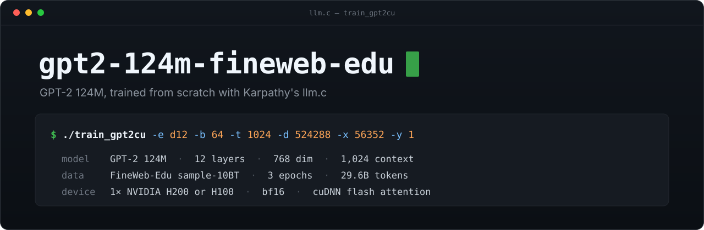
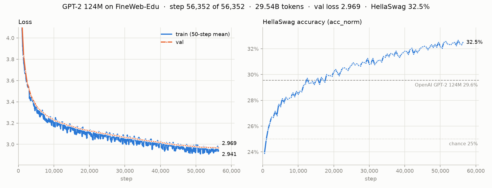

<p align="center">
  
</p>

<p align="center">
  <a href="https://github.com/karpathy/llm.c"></a>
  <a href="https://huggingface.co/datasets/HuggingFaceFW/fineweb-edu"></a>
  
  
  <a href="LICENSE"></a>
</p>

GPT-2 124M trained from scratch on three epochs of FineWeb-Edu sample-10BT (29.6B tokens) on one GPU at a time: an H200 for 85% of the steps and an H100 for the rest. The training code is Andrej Karpathy's [llm.c](https://github.com/karpathy/llm.c), unmodified, included as a git submodule. This repo holds the rest: data preparation, the build, Slurm jobs, evaluation and results.

## Results

| Model | Training data | Val loss ↓ | HellaSwag ↑ |
|:--|:--|:-:|:-:|
| OpenAI GPT-2 124M | WebText | – | 29.55% |
| Abhinav Abhi<sup>1</sup> | FineWeb-Edu 10BT × 3 | 2.95 | 32.8% |
| **This run** | FineWeb-Edu 10BT × 3 | 2.969 | 32.49% |

HellaSwag first passes OpenAI's GPT-2 124M at step 12,500 (6.6B tokens) and stays above it from step 18,000, early in the second epoch. It keeps climbing through the third epoch, to a best of 32.66% at step 55,000. Val loss levels off at 2.969 over the last 2,000 steps. Abhinav Abhi's run ends a little ahead on both.

<p align="center">
  
</p>

<sub><sup>1</sup> 3 epochs with build-nanogpt on 4× RTX 4070, as reported. Val loss is mean cross-entropy on the first 10.5M tokens of the held-out val shard (the first 100M tokens of sample-10BT): the same tokens build-nanogpt evaluates on 8 GPUs. HellaSwag is acc_norm on all 10,042 validation examples.</sub>

## Setup

| | |
|:--|:--|
| **Model** | GPT-2 124M: 12 layers, 12 heads, 768 dim, 1,024 context |
| **Data** | FineWeb-Edu sample-10BT: 9.85B training tokens, 100M held out for validation |
| **Schedule** | 3 epochs, 56,352 steps of 524,288 tokens, reshuffled every epoch |
| **Optimizer** | AdamW, LR 6e-4 with 715 warmup steps, cosine decay to 6e-5, weight decay 0.1 |
| **Compute** | 1× NVIDIA H200 for 48,000 steps and 1× H100 for 8,352; bf16, cuDNN flash attention; 8-hour and 1-hour Slurm jobs that resume from checkpoints |

The recipe follows Karpathy's [Let's reproduce GPT-2 (124M)](https://www.youtube.com/watch?v=l8pRSuU81PU), which trains for one epoch. Three epochs is about 12 times the compute-optimal token count for 124M parameters (Chinchilla rule of thumb: 20 tokens per parameter, about 2.5B). The run measures how much a small model keeps gaining from repeated passes over a small, high-quality dataset.

<details>
<summary><b>Compared with Karpathy's video and Abhinav Abhi's run</b></summary>

| | Karpathy's video | Abhinav Abhi | This run |
|:--|:--|:--|:--|
| Code | build-nanogpt (PyTorch) | build-nanogpt (PyTorch) | llm.c (CUDA C) |
| Hardware | 8× A100 80GB | 4× RTX 4070 | 1× H200 (85% of steps) or 1× H100 |
| Steps | 19,073 (1 epoch) | 56,384 (3 epochs) | 56,352 (3 epochs) |
| Data order | single pass | same order every epoch | reshuffled every epoch |
| Wall time | | 49 h | 20.4 h, of which 18.2 h on the GPU |

llm.c reads each data shard in whole micro-batches of 64 × 1,024 tokens and skips the remainder. One epoch is therefore 18,784 steps here, slightly fewer than the post's. The exact flags are in [`scripts/train_flags.sh`](scripts/train_flags.sh).

</details>

## Reproduce

Written for Northeastern's Explorer cluster (Slurm). To use another cluster, edit the partition names, the GPU name, and the module names in [`env.sh`](env.sh).

```bash
git clone --recurse-submodules https://github.com/as-obaid/gpt2-124m-fineweb-edu.git && cd gpt2-124m-fineweb-edu
cp env.local.example.sh env.local.sh            # your Slurm account and paths
source env.sh && bash scripts/setup.sh           # cudnn-frontend and the Python env

$PY -I scripts/download_fineweb_edu_10bt.py      # 27 GB; run on the transfer node
$PY -I scripts/download_gpt2_and_hellaswag.py    # tokenizer, GPT-2 baseline, HellaSwag

sbatch scripts/tokenize_fineweb_edu_10bt.sbatch  # ~30 min on 64 CPUs
sbatch scripts/smoke_test.sbatch                 # build, baseline, 200 steps, resume check
bash scripts/submit_train.sh                     # 4 chained 8-hour training jobs
bash scripts/submit_chunks.sh                    # optional: 1-hour H100 jobs while those queue
```

Compute nodes have no internet, so the downloads come first. Training writes `runs/gpt2_124m_3ep/main.log` with metrics, plus a checkpoint every 500 steps; each job resumes from the newest checkpoint.

<details>
<summary><b>Running llm.c unmodified</b></summary>

- **Offline tokenizing.** llm.c's `fineweb.py` loads the dataset by its Hugging Face name, which needs internet. [`run_fineweb.py`](scripts/run_fineweb.py) runs the script unchanged and points that name at the 14 downloaded parquet files, which are exactly what Hugging Face's `sample-10BT` config lists. It also sets the worker count to the CPUs Slurm allocated.
- **HellaSwag.** llm.c downloads HellaSwag from the original GitHub repo, which now returns HTTP 451. The same 10,042 validation examples are written from the author's Hugging Face copy, [Rowan/hellaswag](https://huggingface.co/datasets/Rowan/hellaswag).
- **Build.** llm.c's Makefile looks for cudnn-frontend in `$HOME` or `llm.c/`, so [`build_llmc.sh`](scripts/build_llmc.sh) links it there. It also adds `-lnvrtc`, which recent cudnn-frontend needs, on the `make` command line.
- **Resuming.** `-y 1` restores the model, the optimizer and the data loader from the newest checkpoint. The smoke test checks that a resumed run matches an uninterrupted one step for step. One checkpoint can't be resumed: one taken while the loader is in the short last shard, because llm.c's `load_state` asserts that the saved shard has as many batches as the shard the loader opens at startup. If a job dies just after such a checkpoint, rename its `DONE_<step>` file to something that doesn't start with `DONE_`. The next job then resumes from the checkpoint before it and replays the same steps exactly. This happened once here, at step 54,000.

</details>

<details>
<summary><b>Repository layout</b></summary>

```
llm.c/        submodule: karpathy/llm.c @ f1e2ace, unmodified
env.sh        shared paths and pinned versions (overrides in env.local.sh)
scripts/      setup, downloads, tokenizing, build, smoke test, training
results/      logs, figures and summary
assets/       README images
```

</details>

## Credits

- **Andrej Karpathy:** [llm.c](https://github.com/karpathy/llm.c), [build-nanogpt](https://github.com/karpathy/build-nanogpt), and the video [Let's reproduce GPT-2 (124M)](https://www.youtube.com/watch?v=l8pRSuU81PU).
- **Abhinav Abhi:** peer comparison and inspiration.
- **Data:** [FineWeb-Edu](https://huggingface.co/datasets/HuggingFaceFW/fineweb-edu), Penedo et al., 2024; [HellaSwag](https://huggingface.co/datasets/Rowan/hellaswag), Zellers et al., ACL 2019.
- **Model:** GPT-2, Radford et al., OpenAI, 2019.
- **Compute:** Northeastern University Research Computing, Explorer cluster.

## License

MIT for the code in this repo, see [LICENSE](LICENSE). llm.c has its own MIT license. FineWeb-Edu, and models trained on it, are under ODC-By 1.0.

<sub>Muhammad Obaidullah</sub>
